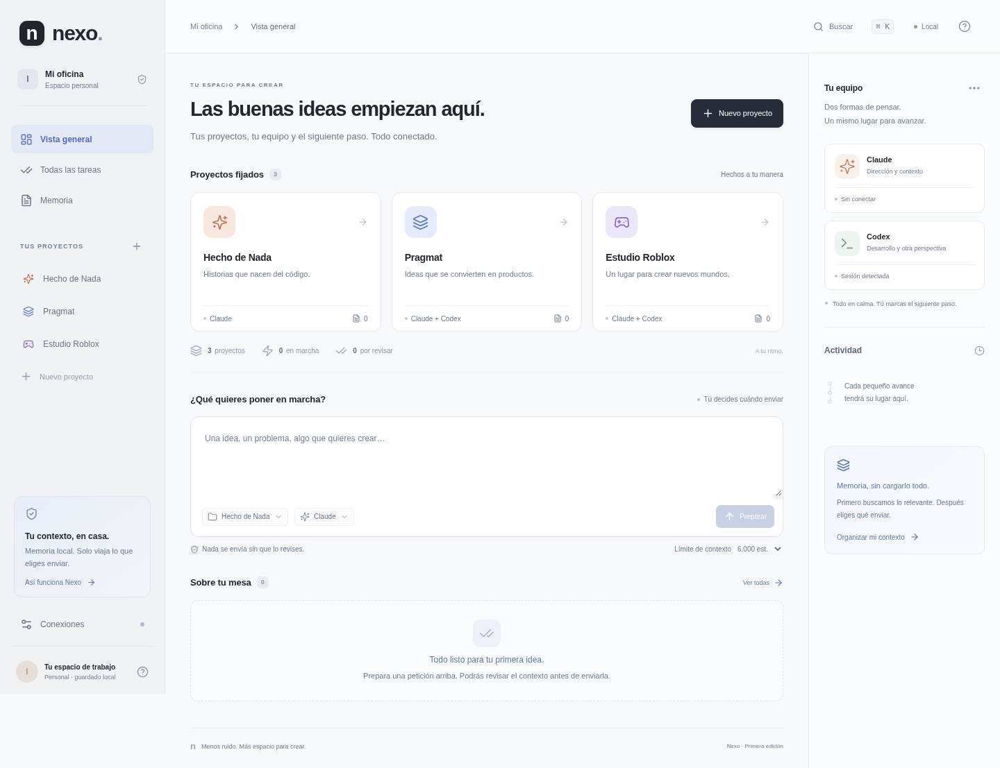

# Nexo

**Tu oficina personal de proyectos e IA.** Una aplicación local, en español, para organizar proyectos, consultar su contexto por partes y preparar trabajo para Claude y Codex.

Esta es una primera versión funcional. La organización, la memoria y las exportaciones funcionan sin conectar modelos. Las consultas por CLI son opcionales, de solo lectura y se inician con un botón. La implementación autónoma y el control de Studio o Buffer quedan para una fase posterior.



[Ver la interfaz móvil](docs/imagenes/nexo-movil.png) · [Comprobaciones y límites de esta entrega](docs/VERIFICACION.md)

**Para ver el diseño sin instalación:** abre el `index.html` de la raíz en el visor o en un navegador. Es una vista autónoma con CSS y JavaScript incluidos; no necesita puertos ni servidor. Permite navegar por las pantallas, con las conexiones y el guardado desactivados. `npm run build` la actualiza y genera una copia descargable llamada `Nexo.html`. La entrada fuente de la aplicación completa está en `web/index.html`.

## Para Iván: llévalo a tu ordenador

Puedes darle esto a Claude Code:

> Clona https://github.com/ivanhierrezuelo4-dev/CLAUDE-y-CODEX en una carpeta nueva de mi ordenador. Lee CLAUDE.md y README.md, comprueba los requisitos y deja Nexo funcionando. Conserva mis configuraciones de MCP, Roblox Studio y Buffer. No uses API de pago ni cambies mis proyectos sin mi autorización. Ayúdame a importar los documentos de contexto que ya preparé. Explícame solo lo que deba hacer yo, paso a paso.

Cuando termine la preparación, abre **Abrir-Nexo.cmd** en Windows o **Abrir-Nexo.command** en macOS. Conserva abierta su ventana mientras uses la oficina. La interfaz está disponible únicamente en tu ordenador, en el puerto 4317. No hace falta exponerla a Internet.

## Preparación técnica

Para explorar el diseño dentro de una vista web del entorno, se ha añadido `npm run preview` después de `npm run build`. Sirve una vista de prueba en el puerto **3000**, admite mostrarse incrustada y usa una base de datos independiente en memoria. No abre `.nexo`, no inspecciona sesiones y rechaza operaciones de guardado o consulta a IA. El acceso mediante el botón de vista previa depende de que la plataforma dirija su visor a ese puerto. La oficina personal completa sigue arrancándose con `npm start` y conserva sus restricciones de acceso local.

Requisitos: **Node.js 24 LTS**, npm y Git. No necesitas Docker, claves API ni Obsidian instalado.

```sh
npm ci
npm run check
npm run doctor
npm start
```

Desde el directorio del repositorio. Para desarrollar: `npm run dev` (interfaz en el puerto 5173, servidor en 4317). Para actualizar: detener Nexo, conservar `.nexo/`, actualizar el código, ejecutar `npm ci` y `npm run build`. El lanzador solo compila cuando no existe `dist/`; no sustituye la compilación tras actualizar.

## Qué puedes hacer ahora

- Crear proyectos y elegir «solo Claude», «solo Codex» o «Claude + Codex». Hecho de Nada comienza solo con Claude; Pragmat y Roblox, con ambos.
- Importar `.md`, `.txt`, `.csv`, `.json` y `.xlsx`. Excel se convierte en texto localmente, con todas sus hojas, usando los valores guardados. No se ejecutan fórmulas ni macros. Máximo 5 MB de archivo y 200.000 caracteres por documento; Excel admite hasta 30 hojas.
- Separar el contexto por proyecto, fijar documentos esenciales y buscar fragmentos relevantes con SQLite FTS5. Reimportar el mismo nombre actualiza su contenido; reimportar el mismo contenido no duplica documentos.
- Preparar una petición sin enviar nada a una IA, revisar las fuentes y descargar su contenido exacto.
- Elegir un presupuesto estimado de contexto. Los documentos fijados no se recortan: si no caben, Nexo avisa.
- Exportar la memoria como carpeta Markdown comprimida: se puede abrir como bóveda de Obsidian o importar en otras herramientas que acepten Markdown. No hay sincronización con Obsidian ni con Notion.
- Detectar herramientas locales, activar consultas de manera explícita, seguir su estado, detenerlas, revisar sus resultados y solicitar una segunda opinión al otro proveedor. La segunda opinión también se prepara y confirma por separado.
- Guardar un resultado aprobado en la memoria del proyecto con un botón, sin una llamada adicional para resumirlo. Se conserva el resultado completo y se busca por fragmentos; no se incorpora entero a cada petición.
- Descargar una exportación JSON de proyectos, documentos, peticiones y actividad.

No hay contenido de ejemplo fingiendo ser trabajo real, porcentajes de progreso inventados, saldo simulado ni llamadas a modelos al abrir la aplicación.

## Conexiones y consumo

**Nexo no incluye los modelos ni amplía sus límites.** Usa las herramientas oficiales instaladas en el mismo ordenador y su autenticación local. La detección requiere una sesión de suscripción reconocible; si es desconocida o solo API, la ejecución se bloquea. No se guardan claves en la aplicación.

- **Codex:** integración mediante `codex exec --json` en sandbox de solo lectura. Esta implementación requiere una CLI reciente que admita `--ignore-user-config` y `--ephemeral`. No carga la configuración global habitual de Codex; conserva la autenticación y fuerza el proveedor OpenAI. Las reglas o instrucciones del proyecto y el propio entorno de la CLI pueden aportar contexto adicional.
- **Claude:** adaptador mediante Claude Code en modo de impresión, sin herramientas, sin servidores MCP externos y con un turno máximo. Requiere una versión con `claude auth status --json`. **La disponibilidad técnica no confirma que una modalidad de suscripción permita una interfaz propia: hay que validar las condiciones vigentes de Anthropic antes de activarlo.** Si exige API, se decide por separado contigo; Nexo no cambia automáticamente de modalidad.
- **Conexiones existentes:** Nexo no modifica tu MCP, Studio ni Buffer. En esta edición, tampoco los controla. Claude Code puede seguir utilizándolos por su flujo habitual fuera de Nexo.

Instalar la CLI no demuestra que haya sesión; una sesión no demuestra que quede cupo. El diagnóstico solo informa lo verificable. La compatibilidad de ambos adaptadores en el PC, especialmente Windows, requiere una prueba allí. Se ha construido un lanzador para Windows, pero esta entrega se valida en Linux.

**Contexto y tokens:** la búsqueda y la preparación se ejecutan sin IA. La estimación es `caracteres / 3`, no un tokenizador del proveedor. Cubre el paquete preparado, no sus instrucciones internas, lecturas adicionales, respuesta ni facturación. Si una herramienta comunica uso real, se muestra separado. No se promete un porcentaje de ahorro ni calidad garantizada. Revisa la selección, fija instrucciones esenciales y amplía el presupuesto cuando falten fuentes.

Cada petición tiene contexto propio. No se reenvía automáticamente todo el historial. Las decisiones duraderas se guardan importando documentos o pulsando «Guardar en memoria» sobre un resultado aprobado; no hay resúmenes automáticos ni memoria semántica.

## Tus datos

Se guardan en `.nexo/nexo.sqlite`, excluido de Git junto con toda la carpeta `.nexo/`. Los originales importados no se alteran. Para otro directorio de datos se puede definir `NEXO_DATA_DIR` con una ruta local.

**Para trasladar toda tu oficina**, detén Nexo y copia la carpeta `.nexo` completa al nuevo checkout antes de abrirlo. No copies la base de datos mientras está trabajando: SQLite puede tener archivos WAL pendientes. Clonar GitHub solo lleva el código, no tus documentos ni tus sesiones. La exportación JSON es un respaldo lógico legible; esta versión aún no ofrece un asistente para restaurarlo. Para recuperar directamente la oficina, usa la copia completa de `.nexo` hecha con Nexo detenido.

No subas la memoria, claves ni documentos de clientes al repositorio. Las exportaciones que descargues sí contienen tu contexto: guárdalas como documentos privados. Las carpetas de otros proyectos no se recorren automáticamente. Vincular una carpeta es opcional y permite que Codex la consulte con sus permisos; no la importa como memoria.

## Validación

```sh
npm run check
```

Ejecuta pruebas de selección de contexto, aislamiento entre proyectos, actualización del índice, presupuesto, permisos HTTP, estados de tareas, concurrencia, cancelación y eventos de proveedores; después compila TypeScript y el frontend.

Pruebas de navegador (no llaman a modelos):

```sh
npx playwright install chromium
npm run build
npm run test:browser
```

Si el entorno ya tiene Chromium, define `CHROMIUM_PATH` con su ejecutable en vez de descargar otro. Cierra la instancia de Nexo antes de estas pruebas: usan el mismo puerto y una base de datos temporal independiente. Los adaptadores de modelos se prueban con ejecutores inyectados en tests; **esto no equivale a una consulta real con tus suscripciones**.

## Próximos pasos

1. Validar acceso permitido, autenticación y una consulta real por proveedor en el PC.
2. Probar con los documentos reales de un proyecto y medir selección de contexto y correcciones.
3. Incorporar conversaciones continuas con referencias explícitas y decisiones aprobadas.
4. Añadir implementación con permisos delimitados, evidencias de pruebas y revisión antes de integrar cambios.
5. Conectar Studio/MCP y Buffer de forma explícita, aprovechando lo ya configurado.
6. Ampliar tarjetas de actividad con tiempo y consumo que los proveedores realmente expongan.

El diseño de esta edición usa fuentes del sistema, iconos locales y una estética sobria. No carga tipografías remotas ni rastreadores.
