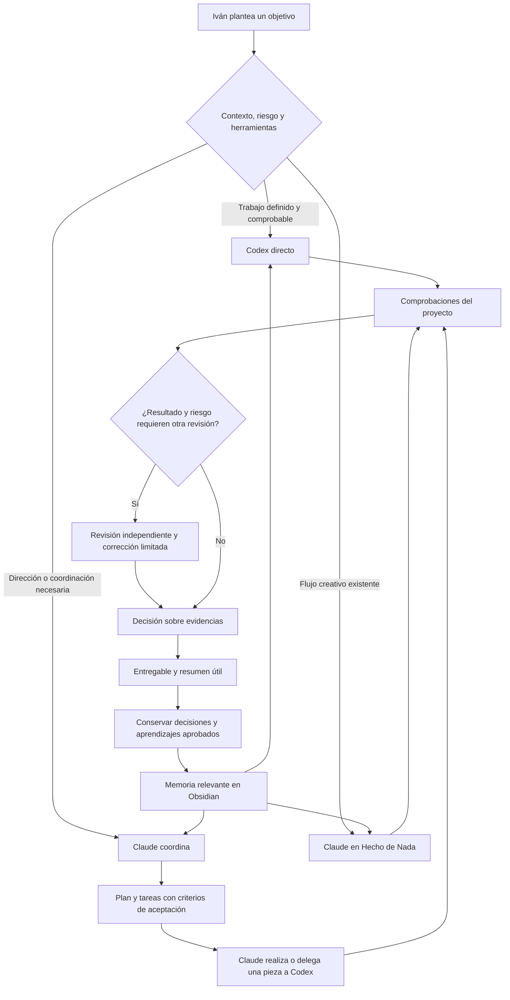

# Claude + Codex + Obsidian: investigación y propuesta de trabajo

**Fecha de consulta:** 2 de noviembre de 2026. **Destinatario:** Iván. **Estado:** investigación y planificación; no es una instalación ni un sistema construido.

## 1. Veredicto

**Sí vale la pena probar el flujo. Todavía no está justificado construir otra aplicación ni un mod propio.** La combinación inicial más razonable es Claude Code con el plugin oficial de Codex, una memoria documental pequeña y una forma de seguimiento ya existente. La ventanita flotante se elige después de comprobar qué información falta.

La decisión principal no debería ser «proyecto grande = Claude; tarea pequeña = Codex». Conviene decidir por **ambigüedad, riesgo, contexto disponible, herramientas necesarias y capacidad de comprobar el resultado**. Codex puede resolver trabajos completos y extensos. Claude puede hacer trabajos breves sin delegarlos cuando la coordinación añadiría más coste que valor.

Hecho de Nada conserva su flujo de Claude, su identidad y las conexiones actuales. Pragmat, Roblox y futuros proyectos pueden utilizar rutas diferentes. No hace falta que todos pasen siempre por dos modelos.

### Qué cambia respecto al primer planteamiento de Nexo

- El plugin oficial ya resuelve buena parte de la conexión y la gestión de trabajos de Codex. [S1]
- Claude Code ya documenta una **vista de agentes**; también publica fuentes de mods, aunque su API es de acceso temprano y puede cambiar. [S2–S3]
- Existen barras de estado, medidores y ventanas flotantes. Sus funciones, compatibilidad y acceso a datos son distintos. [S11–S19]
- Obsidian ya tiene búsqueda, vistas de notas mediante Bases y una CLI oficial. También hay skills compatibles con Claude Code y Codex. No hay que inventar una base de conocimiento propia para empezar. [S5–S10]
- Lo pendiente es validar una configuración concreta en el PC y medir si reduce trabajo repetido con calidad suficiente. Ninguna de estas fuentes demuestra por sí sola un ahorro de tokens para los proyectos de Iván.

## 2. Qué investigué y qué no pude comprobar

Consulté repositorios oficiales de OpenAI, Anthropic, Obsidian y Microsoft, además de proyectos comunitarios. Revisé documentación en **inglés**, un widget con README en **español**, un dashboard de autoría japonesa y documentación en **japonés y chino**. Las traducciones del mismo proyecto no cuentan como comprobaciones independientes.

El punto de partida del video es la transcripción reconstruida aportada por Iván y su análisis, no el audiovisual original. No dispongo de un enlace o autor que permita identificar inequívocamente el mod exacto del creador.

Las páginas `code.claude.com`, `platform.claude.com` y `developers.openai.com` respondieron con bloqueo de red en este entorno. No eludí ese bloqueo: utilicé fuentes oficiales disponibles en GitHub y dejo la verificación de precios, condiciones y disponibilidad personal como pendiente. No se instalaron monitores, mods ni conectores para esta investigación, ni se ejecutaron tareas con otros modelos.

**Etiquetas de evidencia usadas aquí:**

- **Confirmado en documentación:** la fuente consultada describe la función; no implica prueba en el PC.
- **Declarado por un tercero:** afirmación del mantenedor, sin auditoría independiente.
- **Propuesta:** criterio de diseño o política inicial que hay que medir.
- **Pendiente:** no hay comprobación suficiente o depende de cuenta, versión o sistema operativo.

## 3. Comprobación de las ideas del video

| Afirmación | Evaluación | Consecuencia práctica |
|---|---|---|
| Existe `openai/codex-plugin-cc` | Confirmado en el repositorio de OpenAI. [S1] | Utilizar esa base antes de construir un puente nuevo. |
| Permite delegar y revisar desde Claude Code | Confirmado: revisión, revisión adversarial, rescate/delegación, transferencia, estado, resultado y cancelación. [S1] | Probar una tarea y una revisión en el PC. |
| La integración actual es solamente `codex exec` | Incompleto: el plugin oficial consultado envuelve **Codex app-server** y utiliza la CLI y autenticación locales. `codex exec` sigue siendo otra vía de automatización. [S1] | No duplicar el protocolo del plugin sin una necesidad concreta. |
| Claude y Codex suman sus saldos | Incorrecto si se interpreta como un saldo común. | Cada autenticación mantiene su cupo y condiciones; no convertir sus porcentajes en una reserva unificada. |
| Delegar siempre ahorra tokens | No demostrado; el traspaso, la revisión y los reintentos también consumen. | Comparar el flujo completo con una ejecución directa. |
| Hay que tener dos revisores permanentes | No justificado para todo trabajo. | Asignar revisión por riesgo y evidencia; evitar revisiones recursivas. |
| Sol, Astra y Luna son nombres inventados del video | Hoy aparecen en el catálogo público de Codex; también aparece Terra. [S4] | Usar los identificadores reales cuando la cuenta los ofrezca. |
| Opus, Sonnet y Haiku 5.5 existen | Aparecen en el historial oficial consultado. [S2] | Esto no demuestra que todos estén disponibles en la suscripción de Iván. |
| El mod del video está disponible para instalar | No identificado. | No atribuir a un proyecto parecido la autoría del video. |
| Un panel muestra exactamente cuánto falta | Normalmente no hay un progreso total o ETA fiable en tareas abiertas. | Mostrar etapas y comprobaciones reales; tiempo restante desconocido cuando corresponda. |
| Obsidian recuerda todo automáticamente para ambas IA | Incorrecto. La bóveda guarda archivos; cada agente necesita recuperar y leer lo pertinente. [S5] | Diseñar acceso selectivo y actualización de conocimiento. |

La arquitectura útil del video es **planificar → realizar → comprobar → decidir → conservar lo aprendido**. La cantidad de agentes y el modelo concreto son decisiones variables.

## 4. Opciones ya hechas: qué probar y qué descartar por ahora

| Opción | Qué cubre | Qué no demuestra o qué exige | Recomendación |
|---|---|---|---|
| Plugin oficial Codex para Claude Code | Delegación, revisiones, trabajos en segundo plano, `/codex:status`, `/codex:result`, `/codex:cancel`. [S1] | No crea una memoria conjunta de Projects ni garantiza un panel de todos los agentes. | **Base recomendada.** |
| Vista nativa de agentes de Claude Code | El changelog introduce `claude agents` en 2.1.139: sesiones en ejecución, bloqueadas y terminadas. [S2] | Comprobar versión instalada y si los trabajos externos de Codex aparecen relacionados; no asumirlo. | **Primera prueba de visibilidad.** |
| `ccstatusline` | Modelo, contexto, tokens y otras métricas configurables; documentación de Windows. [S11] | Principalmente una barra de terminal de Claude; no es un orquestador conjunto. Las métricas dependen de las fuentes configuradas. | Candidato para una barra compacta. |
| `ccusage` | Informes locales de uso de varias CLI, incluido `ccusage codex daily`; caché y opción de ocultar costes. [S12] | No dirige agentes. Un importe calculado no equivale al cobro de una suscripción. | Candidato para auditoría periódica, sin necesidad de tenerlo siempre abierto. |
| Claude Code Usage Monitor | Monitor de terminal; distingue datos oficiales recientes, estimaciones, datos experimentales y desconocidos. [S13] | Se centra en Claude; requiere configuración y no convierte previsiones en cuotas oficiales. | Solo si hace falta ese nivel de seguimiento. |
| `barracodev/agent-usage-monitor` | README en español: widget arrastrable de Windows con Claude y Codex; declara usar `statusLine` y `account/rateLimits/read`, sin leer credenciales. [S14] | Versión de paquete 0.1.0; no confirmé un instalador publicado. Muestra cuotas, no todo el árbol de tareas. No se auditó ni probó. | **Candidato de evaluación, no recomendación de instalar a ciegas.** |
| HarnessMonitor | Ventana flotante que declara mostrar sesiones activas, inactivas y esperando al usuario, con varias herramientas. [S15] | Windows requiere WSL2 y piezas compatibles; macOS figura experimental. No asumir compatibilidad con CLI nativas de Windows. | Evaluar únicamente si encaja con el entorno existente. |
| Codex + Claude Usage Tracker | Panel de Windows arrastrable y siempre visible, con estética de terminal y cuotas. [S16] | Su documentación describe lectura de credenciales OAuth de Claude. | No es la opción por defecto para este plan; preferir datos de estado autorizados sin extraer credenciales. |
| FleetView, documentación japonesa | Dashboard de sesiones de Claude por hooks y reportes Markdown. [S17] | No encontré soporte de Codex declarado en el README revisado. Es otro servidor/panel que mantener. | Referencia de diseño por eventos, no solución conjunta asumida. |
| CC Switch, documentación china y japonesa | Gestión de proveedores, MCP, skills y prompts. [S18] | Cambiar proveedor/API no equivale a coordinar las suscripciones originales. | No añadirlo para resolver esta necesidad. |
| Claude Squad | Gestiona agentes en espacios de trabajo separados. [S19] | Necesita tmux y gh; su README incluye instrucciones de Codex con API key, no validación de las cuentas actuales. | Alternativa de mayor complejidad, no primer paso. |
| Vibe Kanban | Ejemplo existente de tablero para varios agentes. [S20] | Su README anuncia que está cerrando: “Vibe Kanban is sunsetting”. | No elegirlo como base nueva sin aclarar continuidad. |
| PowerToys Always On Top | Fija una ventana de Windows sobre las demás; atajo predeterminado Win+Ctrl+T. [S21] | No recopila estados ni convierte una pestaña interna en un widget independiente. | Posible complemento a una ventana que ya funcione. |

**Orden recomendado:** seguimiento nativo + plugin → una barra o informe si falta una métrica → ventana existente compatible → mod pequeño solo si queda un hueco demostrado. No instalar todo el catálogo.

### Qué significa realmente «hacer un mod»

El repositorio oficial de Claude Code publica mods, incluidos ejemplos de paneles como `/diff`. Su README advierte que los módulos de hooks necesitan la función habilitada y que la API puede cambiar sin aviso. [S3]

Por tanto, antes de diseñar un mod: comprobar versión, superficie utilizada —terminal, VS Code o desktop— y contrato soportado. Un panel dentro de Claude **no equivale** a una ventana del sistema operativo que siga visible al cambiar de aplicación. Para esto último conviene evaluar un widget existente o fijar una ventana. No parchear binarios ni depender de una API interna no documentada.

## 5. Modelos: hechos y política inicial propuesta

### Catálogo consultado

| Modelo | Identificador observado | Evidencia y límite |
|---|---|---|
| GPT‑6.1 Sol | `gpt-6.1-sol` | El catálogo lo describe como modelo general actual para programación y trabajo cotidiano. |
| GPT‑6.1 Terra | `gpt-6.1-terra` | Figura como modelo Codex; la descripción no demuestra que supere a Sol en todos los trabajos. |
| GPT‑6 Astra | `gpt-6-astra` | Descrito como modelo para el trabajo más exigente. No es una certificación específica de seguridad. |
| GPT‑6 Luna | `gpt-6-luna` | Descrito como rápido y asequible para tareas más sencillas. |
| Claude Opus 5.5 | `claude-opus-5-5` | Nombre e identificador presentes en el changelog oficial. |
| Claude Sonnet 5.5 | `claude-sonnet-5-5` | Nombre e identificador presentes en el changelog oficial. |
| Claude Haiku 5.5 | `claude-haiku-5-5` | Alta explícita en 2.1.293; no tomar ese anuncio como tabla de precios actual completa. |

Fuentes: [S2, S4]. Son presencia documental y posicionamiento declarado, no un benchmark comparativo. El catálogo activo de la cuenta, región, proveedor y versión puede ser distinto.

El catálogo de Codex consultado admite `low`, `medium`, `high`, `xhigh` y `max` para los cuatro modelos destacados. Sol, Terra y Astra incluyen además `ultra`, descrito como razonamiento máximo **con delegación automática**; Luna no lo incluye. Los valores predeterminados tampoco son todos iguales. [S4] No usar `ultra` como ajuste rutinario para ahorrar ni trasladar estas etiquetas mecánicamente a Claude.

Claude también cambia sus controles por versión. El changelog incluye configuración de esfuerzo de subagentes y advertencias de caché al cambiar modelo/esfuerzo. [S2] La instalación real debe confirmar las opciones que admite cada modelo.

### Enrutamiento inicial para validar

Esta tabla es una **propuesta**, no un ahorro o una calidad demostrados:

| Trabajo | Primera ruta | Escalar cuando… |
|---|---|---|
| Formatear un informe o generar una lista a partir de datos claros | Plantilla o script sin LLM; si hace falta lenguaje, Haiku 5.5 o Luna, esfuerzo bajo/medio disponible. | Aparecen contradicciones, interpretación de negocio o pérdida de datos relevantes. |
| Brief, documentación explicativa y plan acotado | Sonnet 5.5, esfuerzo medio si está disponible. | Hay requisitos ambiguos, decisiones costosas de revertir o arquitectura compleja. |
| Dirección de proyecto o diseño con mucha ambigüedad | Claude coordinador; Sonnet u Opus 5.5 con esfuerzo alto según dificultad. | El trabajo sigue sin acotarse: resolver la incertidumbre antes de lanzar más ejecutores. |
| Implementación definida, corrección y pruebas | Codex con Sol 6.1 medio/alto. | El fallo exige razonamiento más profundo; usar alto antes de multiplicar agentes. |
| Alternativa especializada de implementación | Comparar Terra 6.1 con Sol en unas tareas representativas del proyecto. | Solo cambiar el valor por defecto si mejora el resultado total, incluida la revisión. |
| Bug difícil o revisión crítica | Astra alto u Opus alto, con evidencia, pruebas y contexto suficiente. | Sigue sin resolverse: investigación de causa, persona responsable o experto; no un bucle infinito. |
| Cambios menores bien definidos | Ir directo a Codex o resolver con el Claude actual. | La coordinación se vuelve necesaria por dependencias, herramientas o decisiones. |
| Hecho de Nada | Mantener Claude y el modelo/flujo creativo ya aprobado. | Delegar una pieza técnica solo si Iván lo quiere y existe una prueba de equivalencia. |

Un modelo pequeño no debe certificar por sí solo que pagos, permisos o economía están correctos. Un modelo grande tampoco sustituye pruebas. Evitar cambiar de modelo para cada párrafo: las sesiones, la caché y los traspasos también tienen coste.

### Suscripción, API y “saldo”

El plugin confirma que utiliza la instalación/autenticación local de Codex y que el uso contribuye a sus límites. [S1] No garantiza un cupo ilimitado, un plan concreto ni permiso para reutilizar autenticaciones en cualquier producto externo.

No mezclar: tokens procesados, contexto ocupado, cuota de suscripción, precio equivalente por API y dinero realmente facturado. No activar una API como sustituto automático. La ruta recomendada conserva las herramientas oficiales y deja el monitor como observador. Las condiciones vigentes se deben verificar antes de cualquier puente distinto.

## 6. Flujo de trabajo propuesto



### Contrato mínimo de una tarea delegada

Objetivo; entrada/contexto y fuentes; alcance permitido; dependencias; criterios de aceptación; pruebas previstas; responsable; entregable; dudas que obligan a detenerse. La extensión depende de la tarea: no existe la regla de cinco líneas.

La respuesta debe distinguir realizado, comprobado, fallido y pendiente; incluir cambios o referencias pertinentes y un resumen proporcionado. “El agente terminó” no equivale a “la tarea está bien”.

### Revisión proporcionada

- Trabajo rutinario: comprobaciones y revisión normal del responsable.
- Integración relevante: una revisión independiente dirigida a los riesgos concretos.
- Pagos, datos sensibles, permisos o economía persistente: pruebas específicas, revisión independiente y decisión humana para acciones de impacto.

Como política inicial, una revisión adicional y hasta dos intentos de corrección antes de replantear la causa. Es un límite de coordinación propuesto, no una excusa para entregar pruebas fallidas. No activar un ciclo automático permanente: el plugin advierte expresamente de su potencial para agotar límites. [S1]

El paralelismo solo ayuda cuando las tareas son independientes. No permitir edición concurrente de los mismos archivos. Elegir aislamiento adecuado cuando realmente haga falta; no crear espacios extra para cada modificación por rutina. Si Claude alcanza su límite, Codex puede continuar tareas ya especificadas; las decisiones nuevas pendientes se conservan como tales, salvo cambio de responsable explícito.

### Ejemplos que el artifact debería simular

1. **Roblox:** tienda de tres objetos → consultar economía y decisiones → plan → Luau y pruebas disponibles → validación en Studio usando la conexión existente → revisión de persistencia/compras → aprobación para publicar. Un test de lógica no sustituye probar el juego.
2. **Pragmat:** nueva página o cambio de producto → consultar oferta vigente y contexto del cliente correcto → implementación y prueba funcional → revisión adicional si hay usuarios/pagos → entrega.
3. **Hecho de Nada:** nueva pieza → Claude usa identidad y procedimiento vigente → producción y revisión audiovisual → Buffer permanece sujeto al flujo aprobado. Codex participa únicamente si hay un problema técnico concreto autorizado.
4. **Codex directo:** arreglo con reproducción y aceptación claras → búsqueda de las notas pertinentes → solución y comprobaciones → explicación y aprendizaje; Claude no tiene que intervenir por sistema.
5. **Proyecto nuevo:** ficha mínima, fuentes existentes, herramientas y modo preferido → una primera tarea. No comenzar por una taxonomía o infraestructura enormes.

## 7. Obsidian: conexión y utilidad a largo plazo

### Tres niveles, en este orden

1. **Archivos locales compartidos.** Una bóveda es una carpeta de Markdown. Los agentes con permiso pueden buscar y editar archivos; Obsidian refleja cambios externos. No requiere que un “conector de IA” cargue la bóveda completa. [S5]
2. **CLI oficial cuando aporte valor.** Permite buscar, obtener contexto, crear notas y operar sobre Obsidian. La documentación consultada exige instalador 1.12, recomienda 1.12.7+ y conexión con la app en ejecución. Hay que confirmar instalación y sistema operativo. [S6]
3. **Skills y opciones nativas.** `kepano/obsidian-skills` enseña Markdown de Obsidian, Bases, Canvas y CLI; las skills son compatibles con Claude Code y Codex, pero no son una memoria automática ni eliminan permisos. [S7] Bases ya ofrece tablas y tarjetas sobre notas locales. [S8]

MCP o búsqueda semántica solo si una necesidad medida no queda cubierta. El plugin Claude–Codex y el acceso a la bóveda resuelven problemas diferentes.

### Estructura inicial pequeña

```text
Oficina/
  General/Preferencias.md
  Proyectos/
    Hecho-de-Nada/{Indice,Estado,Identidad,Procedimiento,Decisiones}.md
    Pragmat/{Indice,Estado,Oferta,Procedimiento,Decisiones}.md
    Roblox/{Indice,Estado,Diseno,Economia,Decisiones}.md
    Nuevo-proyecto/...
  Aprendizajes/                 # Solo material que sea reutilizable
  Archivo/                     # Material sustituido, fuera de la búsqueda habitual
```

Es un esquema propuesto, no carpetas creadas. Para clientes con información sensible, valorar bóvedas separadas o permisos de acceso separados: las carpetas y etiquetas no son por sí solas una barrera de seguridad. No anidar bóvedas; la ayuda oficial lo desaconseja por los enlaces. [S5]

### Recuperar sin arrastrar todo

1. Identificar proyecto y propósito.
2. Leer un índice breve y las reglas imprescindibles de esa tarea.
3. Buscar conceptos, rutas y nombres concretos dentro del ámbito permitido.
4. Leer notas o fragmentos con encabezados y contexto suficiente; no cortar justo donde se pierde una condición.
5. Comprobar vigencia y contradicciones. Ampliar la búsqueda cuando falte información.
6. Entregar al agente solo el material necesario, con fuente y revisión/fecha.

La búsqueda textual es una primera opción barata y verificable, pero puede fallar con sinónimos. Obsidian ofrece búsqueda y la CLI documenta `search:context`. [S6, S9] El grafo visual no sustituye una estrategia de recuperación para IA.

Una nota importante debería indicar proyecto, estado —borrador/aprobado/sustituido—, fuente, actualización y ámbito. La información caducada debe apuntar a su reemplazo. Si un Excel es la fuente vigente de precios, la nota enlaza su versión y resume lo necesario; no mantener dos tarifas “oficiales” sin una regla de actualización.

### Cerrar el ciclo de memoria

Después de una tarea, conservar únicamente decisiones, restricciones, soluciones reproducibles o procedimientos reutilizables. Registrar evidencia y validación: un intento fallido no se convierte en solución por haberse escrito. Actualizar una nota existente antes de crear otra duplicada. Guardar conversaciones completas como archivo opcional, fuera del contexto habitual.

Mantener instrucciones de entrada breves en `CLAUDE.md` y `AGENTS.md`, con una fuente común de reglas cuando convenga. No duplicar decenas de páginas en ambos archivos ni asumir que cada enlace se lee automáticamente.

### Cuándo aporta valor

| Etapa | Valor esperado | Coste que hay que vigilar |
|---|---|---|
| Primeras sesiones | Tener a mano identidad, estado y reglas; una carpeta pequeña puede ser suficiente. | Preparar demasiadas categorías sin utilizarlas. |
| Varias semanas | Evitar explicar de nuevo decisiones y repetir fallos ya diagnosticados. | Notas duplicadas, desactualizadas o demasiado largas. |
| Varios proyectos/clientes | Recuperar contexto específico y reutilizar procedimientos comprobados. | Mezclar ámbitos y arrastrar documentos de otro cliente. |
| Meses de uso | Continuidad al cambiar de sesión/modelo y aprendizaje acumulado. | Tratar hipótesis antiguas como hechos o acumular una bóveda imposible de mantener. |

Obsidian puede reducir repetición, pero también aumenta tokens si se lee entero o se usa IA para documentar cada movimiento. El beneficio neto debe medirse.

## 8. Estrategias de eficiencia que protegen la calidad

- **Comprobar herramientas existentes antes de crear otra capa.** Reduce mantenimiento y contexto operativo.
- **Una ruta directa para trabajos definidos.** Evita que tres agentes reformulen la misma instrucción.
- **Recuperación selectiva con búsqueda ampliable.** El objetivo es suficiencia; un presupuesto rígido que excluye reglas esenciales perjudica el resultado.
- **Informes con plantilla y datos de herramientas.** No hace falta otra llamada para embellecer cada registro.
- **Traspasos con referencias y resumen de decisiones.** No reenviar todo el chat; tampoco omitir requisitos o criterios de aceptación.
- **Pruebas concretas antes de revisiones vagas.** Enviar al revisor las evidencias y los riesgos que debe examinar.
- **Sesiones y modelos estables durante trabajo coherente.** Cambiar puede invalidar caché y añadir latencia; el changelog advierte sobre cambios de modelo/esfuerzo. [S2]
- **Caché: distinguir almacenamiento de lectura.** Una lectura cacheada sigue procesando contexto; no equivale a cero tokens ni a uso gratuito. [S12]
- **Subagentes solo para trabajo separable.** Su contexto y sus respuestas también consumen. No usar máximos esfuerzos o delegación automática como ajuste universal.
- **Monitoreo por eventos, sin preguntar continuamente a los modelos qué hacen.** El panel observa, no crea conversaciones de mantenimiento.
- **Ignorar material generado y binario en la recuperación ordinaria.** Bundles, renders y logs enormes no son el contexto inicial de una tarea.

No hay una garantía de “máxima calidad con mínimo absoluto de tokens”. La meta práctica es cumplir los mismos criterios de calidad con menor consumo y menor trabajo total, detectando cuándo hace falta ampliar contexto o esfuerzo.

## 9. Especificación del seguimiento visual

### Datos útiles y honestos

Cada tarjeta propuesta: proyecto, tarea, responsable, modelo real, esfuerzo efectivo, estado, última actualización, etapa actual y bloqueo. Separar **sesión**, **tarea** y **agente**: una sesión puede contener varias tareas y el plugin puede manejar trabajos externos.

Para consumo, mostrar solo campos disponibles y su procedencia: entrada, salida, razonamiento y caché cuando se comuniquen; evitar sumas dobles. Distinguir contexto ocupado, cuota usada de la suscripción y coste monetario. Un dato ausente es “sin dato”; uno antiguo, “desactualizado”, nunca 0 % inventado.

“Por qué consumió tanto” puede explicar factores observables: material leído, tamaño de salida, reintentos, revisiones, cambio de modelo, aciertos/fallos de caché y llamadas de herramientas. No puede revelar el razonamiento interno privado ni atribuir toda la factura a una causa sin telemetría suficiente.

El tiempo transcurrido es observable. El tiempo restante suele ser desconocido. Un avance como “2 de 4 verificaciones terminadas” es defendible si existe esa lista; un “87 % completo” basado en intuición no lo es.

### Estética propuesta para el artifact

Inspiración de interfaz cyberpunk/anime: fondo oscuro, neón selectivo, tarjetas compactas y tipografía legible. Claude en naranja y Codex en verde, acompañados siempre por texto/icono. Paleta **provisional**, no reproducción verificada de un personaje:

| Función | Color |
|---|---|
| Fondo / superficie | `#0B0E14` / `#151B26` |
| Texto principal | `#EDF2F7` |
| Claude | `#F08A5D` |
| Codex | `#55D98B` |
| Navegación / acento | `#00E5FF` |
| Destacado cyberpunk | `#FCEE0A`, con texto oscuro |
| Atención / bloqueo | `#FF5C7C`, con etiqueta e icono |

La mención a Edgerunners 2 y Capri es una referencia del usuario. No se verificó su cronología ni una imagen concreta del personaje; no afirmar su estreno ni inventar rasgos. Aplicar esta dirección provisional y permitir ajustarla con una referencia visual más adelante.

El artifact puede simular arrastrar una tarjeta **dentro de su propia superficie**. Esto no demuestra una ventana real entre aplicaciones. Esa capacidad debe corresponder a una herramienta de escritorio compatible; PowerToys puede fijar ventanas existentes en Windows. [S21]

## 10. Qué debería diseñar Claude en el artifact

Un mapa de decisiones interactivo, no otro producto operativo. Elegir proyecto, tipo de trabajo, ambigüedad, riesgo y disponibilidad de proveedores; mostrar la ruta recomendada y por qué. Cambiar entre Claude coordinador, Codex directo y Claude solo. Incluir escenarios y estados de fallo: límite de uso, memoria ausente/caducada, pruebas fallidas y desacuerdo entre revisores.

Secciones: recomendación; selector de ruta; modelos/esfuerzo; bóveda a corto/largo plazo; demostración de tarjetas; opciones existentes; plan de prueba y fuentes. Los números simulados deben estar etiquetados. Sin llamadas reales a IA ni conexiones al PC. El artifact debe abrirse realmente en el entorno de entrega; compilar o verlo en otra máquina no valida la experiencia de Iván.

**Dónde pedirlo:** Claude con búsqueda web y Artifacts es la vía natural para investigación y documento interactivo. Claude Code puede producir un HTML autónomo si esa es la superficie disponible. Un Artifact de Claude no tiene acceso automático a los archivos y conexiones del PC.

## 11. Prueba antes de invertir en personalización

1. Inventario de solo lectura en el PC: sistema operativo, versiones, acceso a modelos y estado de herramientas; no leer valores de secretos. El plan puede prepararse sin ese inventario, marcando lo desconocido.
2. Elegir ocho a diez tareas representativas y una referencia de cómo se resuelven hoy.
3. Probar las rutas adecuadas, sin obligar a comparar todos los modelos en cada tarea.
4. Medir tiempo total, intervenciones de Iván, correcciones, pruebas ejecutadas, recuperación documental y uso reportado. Separar tokens, costes equivalentes y cuotas reales.
5. Comprobar la memoria con preguntas cuya respuesta conocida existe, incluyendo un documento sustituido y uno de otro proyecto que no debe usarse.
6. Mantener la configuración más sencilla que cumpla los criterios. No ampliar por estética antes de que el flujo funcione.

La aceptación exige pruebas pertinentes aprobadas, requisitos cumplidos y ausencia de errores críticos conocidos. Si el consumo baja pero aumenta el trabajo que hay que rehacer, la propuesta no ha demostrado valor. Un piloto pequeño orienta; no prueba una superioridad universal ni un porcentaje fijo de ahorro.

## 12. Por qué el prompt adjunto está estructurado así

Utiliza un encargo claro, contexto real, separación entre instrucciones y documentos, evidencia exigida, fases y criterios de aceptación. El tutorial oficial de Anthropic respalda claridad, audiencia, rol y delimitación de datos con etiquetas. [S22] Sus ejemplos antiguos de API, modelos y prefilling no se trasladan como recomendaciones actuales.

El cookbook de Anthropic distingue routing, orquestación, paralelismo y evaluación/optimización. [S23] Se usa para escoger el patrón adecuado, no para asumir que el patrón con más agentes es mejor. El prompt pide conclusiones justificadas y desacuerdos documentados, sin exigir razonamiento interno privado ni una recitación interminable.

## 13. Fuentes consultadas

Acceso: 2 de noviembre de 2026. “Consultada” significa que se pudo leer la fuente, no que el software haya sido instalado o probado. Los repositorios en `main` pueden cambiar; Claude debe revisar vigencia antes de fijar configuración.

| Ref. | Fuente y enlace | Aporta |
|---|---|---|
| S1 | [OpenAI: codex-plugin-cc](https://github.com/openai/codex-plugin-cc/blob/main/README.md) | Funciones, autenticación local, límites y aviso sobre bucles. |
| S2 | [Anthropic: Claude Code changelog](https://github.com/anthropics/claude-code/blob/main/CHANGELOG.md) | Modelos 5.5, agent view en 2.1.139, subagentStatusLine y esfuerzo. |
| S3 | [Anthropic: mods](https://github.com/anthropics/claude-code/blob/main/mods/README.md) y [ejemplo de panel](https://github.com/anthropics/claude-code/blob/main/mods/diff/hooks/register.ts) | Extensión real, paneles y limitaciones de acceso temprano. |
| S4 | [OpenAI: catálogo de modelos](https://github.com/openai/codex/blob/main/codex-rs/models-manager/models.json), [catálogo activo](https://github.com/openai/codex/blob/main/codex-rs/models-manager/src/model_presets.rs) y [normalización de esfuerzo](https://github.com/openai/codex/blob/main/codex-rs/protocol/src/openai_models/reasoning_effort.rs) | Identificadores, descripciones y niveles; no garantiza acceso personal. |
| S5 | [Obsidian: almacenamiento](https://github.com/obsidianmd/obsidian-help/blob/master/en/Files%20and%20folders/How%20Obsidian%20stores%20data.md) | Carpeta Markdown, cambios externos y separación de bóvedas. |
| S6 | [Obsidian: CLI](https://github.com/obsidianmd/obsidian-help/blob/master/en/Extending%20Obsidian/Obsidian%20CLI.md) | Requisitos, búsquedas y contexto. |
| S7 | [kepano: obsidian-skills](https://github.com/kepano/obsidian-skills/blob/main/README.md) | Skills para CLI, Markdown, Bases y Canvas. |
| S8 | [Obsidian: Bases](https://github.com/obsidianmd/obsidian-help/blob/master/en/Bases/Introduction%20to%20Bases.md) | Tablas y tarjetas sobre notas locales. |
| S9 | [Obsidian: Search](https://github.com/obsidianmd/obsidian-help/blob/master/en/Plugins/Search.md) | Búsqueda y sus límites. |
| S10 | [Obsidian: enlaces](https://github.com/obsidianmd/obsidian-help/blob/master/en/Linking%20notes%20and%20files/Internal%20links.md) | Referencias entre notas y formatos. |
| S11 | [ccstatusline](https://github.com/sirmalloc/ccstatusline/blob/main/README.md) y [Windows](https://github.com/sirmalloc/ccstatusline/blob/main/docs/WINDOWS.md) | Barra configurable y compatibilidad declarada. |
| S12 | [ccusage](https://github.com/ryoppippi/ccusage/blob/main/apps/ccusage/README.md) | Informes conjuntos, caché, costes y modo offline. |
| S13 | [Claude Code Usage Monitor](https://github.com/Maciek-roboblog/Claude-Code-Usage-Monitor/blob/main/README.md) | Procedencia de métricas, límites oficiales y estimaciones. |
| S14 | [Agent Usage Monitor, español](https://github.com/barracodev/agent-usage-monitor/blob/main/README.md), [paquete](https://github.com/barracodev/agent-usage-monitor/blob/main/package.json) y [licencia](https://github.com/barracodev/agent-usage-monitor/blob/main/LICENSE) | Widget Windows; versión 0.1.0; licencia MIT; afirmaciones de privacidad sin auditoría propia. |
| S15 | [HarnessMonitor](https://github.com/localhost94/harness-monitor/blob/main/README.md) | Sesiones, ventanas flotantes y límites por plataforma. |
| S16 | [Codex + Claude Usage Tracker](https://github.com/markaljhon/codex-claude-usage-tracker/blob/main/README.md) | Panel Windows y lectura de credenciales documentada. |
| S17 | [FleetView, japonés](https://github.com/hayakiw/fleet-view_for-claudecode/blob/main/README.md) | Eventos de sesiones Claude y reportes Markdown. |
| S18 | [CC Switch, chino](https://github.com/farion1231/cc-switch/blob/main/README_ZH.md) y [japonés](https://github.com/farion1231/cc-switch/blob/main/README_JA.md) | Gestión de proveedores; no confundir con el flujo buscado. |
| S19 | [Claude Squad](https://github.com/smtg-ai/claude-squad/blob/main/README.md) | Multiplexación, dependencias y configuración adicional. |
| S20 | [Vibe Kanban](https://github.com/BloopAI/vibe-kanban/blob/main/README.md) | Aviso de cierre en el README consultado. |
| S21 | [Microsoft: Always On Top](https://github.com/MicrosoftDocs/windows-dev-docs/blob/docs/hub/powertoys/always-on-top.md) | Fijar una ventana existente sobre otras. |
| S22 | [Anthropic: tutorial de prompting](https://github.com/anthropics/prompt-eng-interactive-tutorial), especialmente [claridad](https://github.com/anthropics/prompt-eng-interactive-tutorial/blob/master/Anthropic%201P/02_Being_Clear_and_Direct.ipynb), [rol](https://github.com/anthropics/prompt-eng-interactive-tutorial/blob/master/Anthropic%201P/03_Assigning_Roles_Role_Prompting.ipynb) y [datos/instrucciones](https://github.com/anthropics/prompt-eng-interactive-tutorial/blob/master/Anthropic%201P/04_Separating_Data_and_Instructions.ipynb) | Estructura del encargo; ejemplos técnicos antiguos tratados como tales. |
| S23 | [Anthropic: Building Effective Agents Cookbook](https://github.com/anthropics/claude-cookbooks/blob/main/patterns/agents/README.md) | Patrones de routing, orquestación y evaluación. |

Documentos de Iván utilizados: **Equipo Claude + Codex.md** y **Pasted text.txt**, transcripción/análisis del video. Son contexto y propuestas del usuario; no pruebas independientes de productos, costes o resultados.

**Recomendación final:** probar primero el flujo oficial, usar Obsidian como memoria local selectiva y evaluar seguimiento ya existente. El artifact debe ayudar a decidir y entender el sistema antes de implementar personalizaciones. La inversión en un mod se justifica solamente si queda una carencia concreta tras esa prueba.
